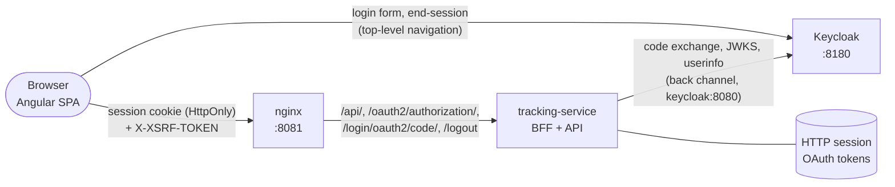

# Security: authentication, authorization and sessions

ParcelFlow's web UI and REST API require an OpenID Connect login. This document describes the model,
how it is wired locally, what it protects, and what it deliberately does not do yet.

- [1. Architecture](#1-architecture)
- [2. The login flow](#2-the-login-flow)
- [3. Keycloak](#3-keycloak)
- [4. Roles and retailer isolation](#4-roles-and-retailer-isolation)
- [5. Sessions](#5-sessions)
- [6. CSRF](#6-csrf)
- [7. Logout](#7-logout)
- [8. API errors](#8-api-errors)
- [9. Hostnames, redirects and Docker](#9-hostnames-redirects-and-docker)
- [10. Configuration reference](#10-configuration-reference)
- [11. Calling the API from a terminal](#11-calling-the-api-from-a-terminal)
- [12. Tests](#12-tests)
- [13. Limitations](#13-limitations)
- [14. Towards a distributed deployment](#14-towards-a-distributed-deployment)
- [15. Phase 3 boundary: service-to-service authentication](#15-phase-3-boundary-service-to-service-authentication)

---

## 1. Architecture

**Backend for Frontend (BFF).** The tracking service is both the business API and the OAuth2/OIDC
confidential client for the Angular UI. There is no separate BFF service.



- The browser holds one credential: an **HttpOnly session cookie**. Script cannot read it.
- **Access, refresh and ID tokens never reach the browser.** They live in the server-side HTTP session
  (`HttpSessionOAuth2AuthorizedClientRepository`) and die with it.
- Nothing authentication-related is stored in `localStorage`, `sessionStorage`, URLs or JS-readable
  cookies. There is no script-readable cookie at all: the CSRF token lives in the server-side session
  and is fetched from `GET /api/auth/csrf` (§6).
- The UI's route guards and hidden buttons are presentation. **Every API request is authorized on the
  server** from the session.

The application owns no passwords and issues no tokens. There is no custom login form, no JWT
generation, no token refresh endpoint: Spring Security 7's OAuth2 Login does the protocol.

## 2. The login flow

1. The UI's **Sign in** button navigates (full page) to `/oauth2/authorization/keycloak`.
2. Spring Security creates the authorization request — `state`, `nonce`, PKCE `code_verifier` and its
   **S256** `code_challenge` — stores it in the HTTP session, and redirects to Keycloak.
3. The user authenticates **at Keycloak**. ParcelFlow never sees the password.
4. Keycloak redirects to `/login/oauth2/code/keycloak?code=…&state=…`.
5. Spring Security checks `state`, exchanges the code at the token endpoint with the PKCE verifier and
   **client authentication** (`client_secret_basic`), and validates the ID token: signature against
   Keycloak's JWKS, `iss`, `aud`, `azp`, `exp`/`iat`, and `nonce`. It fetches userinfo and checks its
   `sub` matches.
6. `ParcelFlowOidcUserService` maps the validated claims to an application role (see §4). A refusal
   fails the login: **no authenticated session is created**.
7. The session id is **rotated** (session fixation protection), the CSRF token is replaced, the login
   time is recorded for the absolute lifetime (§5), and the browser is redirected to `/`. The UI resumes the route it remembered before step 1.

PKCE is required even though the client is confidential: Spring applies it automatically only to
public clients, so the registration sets `ClientSettings.requireProofKey(true)`, and discovery refuses
a provider that does not advertise S256.

## 3. Keycloak

Keycloak 26.8.1 runs in Docker Compose in **development mode** (`start-dev`): in-container H2
database, plain HTTP, realm imported from [`keycloak/realm/parcelflow-realm.json`](../keycloak/realm/parcelflow-realm.json)
whenever the container is created. It is a reproducible local identity provider, not a production
deployment (§13).

**Realm `parcelflow`:**

| Setting | Value |
|---|---|
| Self-registration, password reset, remember-me | off |
| Brute-force protection | on (10 failures, incremental wait) |
| SSO idle / max | 30 min / 10 h |
| Access token lifespan | 5 min |
| Realm roles | `ADMIN`, `RETAILER` |
| User attribute | `retailer_id` — declared in the user profile, single-valued, **view/edit: admin only**, validated `^[A-Za-z0-9][A-Za-z0-9._-]{0,63}$` |

**Client `parcelflow-bff`:** confidential (`client-secret`), standard flow only (no implicit, no
direct access grants, no service account), PKCE method S256 enforced, exact redirect URIs and exact
post-logout redirect URIs for `http://localhost:8081` (nginx), `:4200` (`ng serve`) and `:8080`
(direct). Two protocol mappers put `roles` (realm roles, multivalued) and `retailer_id` (multivalued,
so a second value shows up as an array rather than being silently dropped) into the ID token and
userinfo.

**Local identities** (passwords are generated per machine, see below):

| Username | Role | Retailer | Purpose |
|---|---|---|---|
| `ops.admin` | ADMIN | — | operator |
| `retailer.alpha` | RETAILER | `alpha-goods` | first retailer |
| `retailer.beta` | RETAILER | `beta-supplies` | second retailer, for isolation |
| `retailer.unassigned` | RETAILER | *(none)* | proves fail-closed: login is refused |

User ids (the OIDC `sub`) are fixed in the realm file, so they are stable across re-imports.

**Secrets are not in Git.** The realm file contains `${PARCELFLOW_OIDC_CLIENT_SECRET}`,
`${PARCELFLOW_ADMIN_PASSWORD}` and `${PARCELFLOW_RETAILER_PASSWORD}` placeholders that Keycloak
resolves from the container environment at import. Compose refuses to start until they are set:

```bash
./scripts/init-local-secrets.sh            # generates random values into the git-ignored .env
./scripts/init-local-secrets.sh --print    # also shows the local login passwords
docker compose up -d --build
```

Changing a value later: `docker compose up -d --force-recreate keycloak tracking-service` (the realm
is imported only when the container is created). The admin console is at
<http://localhost:8180/admin> (user `admin`, password `KEYCLOAK_ADMIN_PASSWORD`).

## 4. Roles and retailer isolation

| | ADMIN | RETAILER |
|---|---|---|
| Shipments of | every retailer | their assigned retailer only |
| Register shipments for | any retailer | their retailer only |
| Tracking lookup, history, notifications | any shipment | own shipments |
| Failed events: list, detail, retry | yes | no (403) |
| Simulator command builder (UI) | yes | hidden |
| Health details (`/actuator/health`) | yes | status only |

**Identity mapping — one mechanism, fail closed** (`IdentityMapper`). From the validated claims:

- `sub` must be present. It is the stable identifier; usernames and e-mail addresses are never used
  for authorization.
- `roles` must contain **exactly one** of `ADMIN`, `RETAILER` (case-sensitive). None, or both, is a
  refusal. Keycloak's default roles (`offline_access`, `default-roles-parcelflow`, …) are ignored.
- A RETAILER's `retailer_id` must be **exactly one** string matching the pattern above. Missing,
  multiple, non-string or malformed values are a refusal.

The retailer assignment is server-controlled: it is a Keycloak user attribute that only realm
administrators can set, emitted into a token Keycloak signs and the backend validates. The mapping is
applied at login (a refusal means no session) and re-applied on every request by
`CurrentUserProvider`, so a principal that somehow lacked a valid assignment could never be read as
"no restriction". `CurrentUser` itself cannot be constructed as a RETAILER without a retailer.

**Enforcement** is in the services, not in the UI and not only in URL rules
(`ShipmentAccessService`, decision in `CurrentUser.canAccessRetailer`):

| Request | Another retailer's resource | Why |
|---|---|---|
| `GET /api/shipments/{id}` | **404**, identical to a nonexistent id | no existence disclosure; checked *after* the Redis cache |
| `GET /api/shipments/lookup` | **404**, identical to a miss | tracking numbers cannot be enumerated |
| `GET /api/shipments/{id}/events`, `/notifications` | **404** | same |
| `GET /api/retailers/{retailerId}/shipments` | **403** `retailer-access-denied` | the caller named the retailer; nothing about shipments is disclosed |
| `POST /api/shipments` with another `retailerId` | **403** `retailer-access-denied` | the browser-supplied retailer id is checked, never trusted |
| `POST /api/shipments`, number already used | **409** with `existingShipmentAccessible: false` | see below |
| `/api/admin/**` | **403** `access-denied` | URL rule plus `@PreAuthorize` |

**Duplicates.** `(carrier_code, tracking_number)` stays globally unique: a carrier's tracking number
identifies one parcel, whoever registered it. A duplicate is therefore still a 409 for everyone. The
409 body echoes only the caller's own input plus `existingShipmentAccessible`; it never contains the
existing shipment's id or retailer. The UI offers "Open existing shipment" only when that flag is
true. The residual signal — "this carrier/number pair is registered somewhere" — is inherent in
global uniqueness and is documented as such (§13).

**Background work is unaffected.** The Kafka consumer, dead-letter handling, retries and metrics run
without a user and without any authorization check; `ShipmentService` remains the unscoped domain
service they use. Only the HTTP read/write paths go through `ShipmentAccessService`.

## 5. Sessions

- Servlet-container HTTP sessions (Tomcat, in memory), `SessionCreationPolicy.IF_REQUIRED`. No Spring
  Session/Redis: one instance does not need it (§14).
- **Fixation protection:** `changeSessionId` on login.
- **Idle timeout:** 30 minutes **without user activity** (`parcelflow.security.session.idle-timeout`),
  matching Keycloak's SSO idle timeout. Requests the UI sends on its own — the shipment page's
  polling — carry `X-ParcelFlow-Background: true` and do not count, unless the user clicked, typed,
  scrolled or touched the page since the last request that counted. An open tab therefore no longer
  keeps a session alive indefinitely. Tomcat's own `server.servlet.session.timeout` (30 min, any
  request) still applies underneath.
- **Absolute lifetime:** 8 hours after login (`parcelflow.security.session.absolute-timeout`),
  however active the session is. This is the upper bound on how long a Keycloak-side change — user
  disabled, role or retailer changed, SSO session ended — takes to reach an existing ParcelFlow
  session (there is no back-channel logout, §13).
- Both are enforced by `SessionLifetimeFilter` on every request, after the CSRF filter and before
  authorization: an expired session is invalidated, the request continues as anonymous, and an API
  call gets the usual **401** (a write gets 401 too, not a CSRF 403). The background header is only an
  activity hint; it grants nothing, and omitting it just counts as activity.
- **Cookie (production defaults, `application.yml`):** name `__Host-parcelflow-session`, `Secure`,
  `HttpOnly`, `SameSite=Lax`, `Path=/`, no `Domain`, never in URLs (`tracking-modes: cookie`).
  The `__Host-` prefix makes the browser enforce Secure + host-only + `Path=/`.
- `SameSite=Lax`, not `Strict`: the OIDC callback is a top-level GET arriving from Keycloak's origin,
  and the session (which holds `state`, `nonce` and the PKCE verifier) must accompany it. Lax still
  withholds the cookie from cross-site POSTs and subresources; CSRF tokens cover the rest.
- **HTTPS:** `parcelflow.security.require-https=true` by default redirects plain HTTP to HTTPS
  (behind a TLS-terminating proxy, via `X-Forwarded-Proto`).
- **Local profile** (`application-local.yml`, set by Compose): cookie renamed to `PARCELFLOW_SESSION`
  and not `Secure`, no HTTPS redirect — exactly what `http://localhost` cannot satisfy, nothing else.
- **Restoration after reload:** the UI calls `GET /api/auth/session` on start-up (always 200;
  `authenticated: false` when there is no session) and restores its Signals state from it.
- **Expiry:** the next API call — including a background poll — returns 401; the UI clears its state
  and cached CSRF token and shows the login page with "Your session has ended", remembering the
  route.

## 6. CSRF

A **session-bound synchronizer token** (`HttpSessionCsrfTokenRepository`), not a cookie:

- The token is stored in the server-side HTTP session. The UI gets it from `GET /api/auth/csrf`
  (masked per response, `Cache-Control: no-store`; readable same-origin only — no CORS) and sends it
  in the `X-XSRF-TOKEN` header of every state-changing request (`core/auth/csrf.ts`). Angular's
  built-in cookie-to-header XSRF support is switched off (`withNoXsrfProtection()`).
- **Why not a cookie.** The previous double-submit design (`XSRF-TOKEN` cookie) trusted the cookie's
  integrity: any origin that can set cookies for this host — a sibling subdomain in production; on
  localhost, any other local service, since cookies ignore ports — could plant a token it knows and
  then submit it with a cross-site form. A token in the session cannot be planted; a planted
  `XSRF-TOKEN` cookie is simply ignored (regression-tested in MockMvc, against a real server and in
  Playwright).
- Requests are validated with the **BREACH-safe XOR-masked** encoding (header or `_csrf` field).
  Every value issued stays valid for the session.
- The token is **deferred**: a GET creates no session. Spring replaces it at login, and it dies with
  the session at logout or expiry.
- **Nothing is exempt.** Registration, admin retry, the load-test publisher and logout all require it.
  CSRF is not disabled anywhere.
- A rejected token is a 403 with problem type `csrf-token-invalid`. The UI drops its cached token,
  fetches a fresh one and retries that one request **once** (safe: the server refused it before doing
  anything).

## 7. Logout

1. The UI fetches the masked token from `GET /api/auth/csrf` and submits a **top-level form POST** to
   `/logout` with `_csrf`. (A form, not XHR: the response redirects to Keycloak, which an XHR could not
   follow — and this way the ID token hint in that redirect never passes through script.)
2. Spring Security invalidates the HTTP session (and with it the OAuth tokens and the CSRF token),
   clears the authentication and deletes the session cookie.
3. `OidcClientInitiatedLogoutSuccessHandler` redirects to Keycloak's `end_session_endpoint` with
   `id_token_hint` and `post_logout_redirect_uri={baseUrl}/signed-out` (registered exactly in
   Keycloak). Keycloak ends the **SSO session** and returns the browser to `/signed-out`.
4. `/signed-out` does not redirect anywhere on its own. Its "Sign in again" button adds
   `prompt=login`, so even if the end-session step did not complete, Keycloak asks for credentials
   instead of silently logging the same user back in.

If Keycloak is unreachable at logout, the local session is still invalidated and the browser goes
straight to `/signed-out`.

`prompt=login` is also used after a refused login (`/login?error=not_authorized`): Keycloak then
asks for re-authentication and offers "restart login" to switch account, instead of silently reusing
the refused account's SSO session. Only the literal value `login` is forwarded.

## 8. API errors

Under `/api/**`, `/actuator/**` and `/internal/**`, Spring Security never redirects to an HTML page.
Its entry point and access-denied handler delegate to the same `@RestControllerAdvice` as every other
error, so responses are RFC 9457 `application/problem+json` and carry `X-Correlation-Id`
(`CorrelationIdFilter` runs before the security filter chain):

| Status | `type` slug | Meaning | UI behaviour |
|---|---|---|---|
| 401 | `authentication-required` | no, expired or invalid session | to `/login?reason=expired&returnUrl=…` |
| 403 | `csrf-token-invalid` | missing or stale CSRF token | refresh token, retry once |
| 403 | `retailer-access-denied` | acting for another retailer | error panel |
| 403 | `access-denied` | missing role (ADMIN endpoints) | error panel; ADMIN routes guarded |

An ordinary browser navigation to a protected backend URL outside those prefixes is redirected to the
UI's `/login` route. A login attempt while Keycloak is unreachable goes to `/login?error=idp_unavailable`
— there is **no fallback authentication** of any kind (no Basic, no form login, no bearer tokens).

## 9. Hostnames, redirects and Docker

The hard part of OIDC in Compose is that the **browser** reaches Keycloak at `http://localhost:8180`
while the **tracking-service container** can only reach it at `http://keycloak:8080` — and an
issuer is one exact string that every ID token's `iss` must match.

The fix does not weaken validation:

- Keycloak is told its public URL (`KC_HOSTNAME=http://localhost:8180`) and to answer back-channel
  requests on whatever host they arrive at (`KC_HOSTNAME_BACKCHANNEL_DYNAMIC=true`).
- The tracking service fetches discovery from the internal URL
  (`PARCELFLOW_OIDC_DISCOVERY_URI=http://keycloak:8080/realms/parcelflow/.well-known/openid-configuration`).
  Keycloak's answer advertises the **public** issuer, authorization and end-session endpoints, and
  **internal** token, userinfo and JWKS endpoints.
- `DiscoveringClientRegistrationRepository` refuses that document unless its `issuer` equals
  `PARCELFLOW_OIDC_ISSUER_URI=http://localhost:8180/realms/parcelflow` exactly, and Spring Security then
  validates every ID token against the same value. Outside Docker the two URIs are the same.
- Discovery is lazy: the service starts (health checks, Kafka) while Keycloak is still starting;
  login fails closed until discovery succeeds.

**Redirect URIs** are built from the request (`{baseUrl}/login/oauth2/code/keycloak`), so the backend
must see the URL the browser used. nginx proxies `/oauth2/authorization/`, `/login/oauth2/code/` and
`/logout` (POST only) with `Host: $http_host`, `X-Forwarded-Proto` and `X-Forwarded-Port` (taken from
the browser's Host header — nginx itself listens on 8080), and the service uses Tomcat's RemoteIpValve
(`server.forward-headers-strategy: native`). The Angular dev server proxies the same paths with
`changeOrigin: false`.

**Forwarded-header trust.** A client must not be able to choose the redirect origin:

- nginx **overwrites** `X-Forwarded-Proto` and `X-Forwarded-Port` and **removes** any client-sent
  `X-Forwarded-Host` and `Forwarded` header before proxying.
- The service **ignores `X-Forwarded-Host` entirely** (`server.tomcat.remoteip.host-header: ""`); the
  host comes from the `Host` header, which every supported proxy forwards. RFC 7239 `Forwarded` is
  not read by the native strategy.
- Negative tests: a spoofed `X-Forwarded-Host` / `Forwarded` leaves the `redirect_uri` and the
  `post_logout_redirect_uri` on the real origin (`KeycloakOidcLoginIntegrationTest`, direct to the
  service; `e2e/auth.spec.ts`, through the UI's origin).
- `X-Forwarded-Proto` and `-Port` are still honoured from Tomcat's default *internal* (private-range)
  proxies, because a TLS-terminating proxy needs them. On the direct port (`127.0.0.1:8080`) a local
  caller can therefore still spoof the scheme or port of its *own* request's redirect URI; Keycloak's
  exact redirect-URI match rejects the result. A deployment must not expose the service port and
  should narrow `server.tomcat.remoteip.internal-proxies` to its ingress (§14).

**CSP:** the nginx `form-action` directive includes `OIDC_PROVIDER_ORIGIN` (default
`http://localhost:8180`) because the logout form POST is answered with a redirect to Keycloak.

**Use `localhost`, not `127.0.0.1`,** in the browser: Keycloak matches redirect URIs exactly.

All published ports remain bound to `127.0.0.1`. The API on `:8080` is exactly as protected as through
nginx: same session, CSRF and roles.

## 10. Configuration reference

| Variable / property | Default | Notes |
|---|---|---|
| `PARCELFLOW_OIDC_ISSUER_URI` | *(none; `local` profile: `http://localhost:8180/realms/parcelflow`)* | exact issuer; without it login is disabled |
| `PARCELFLOW_OIDC_DISCOVERY_URI` | issuer + `/.well-known/openid-configuration` | only when the service's network path differs |
| `PARCELFLOW_OIDC_CLIENT_ID` | `parcelflow-bff` | |
| `PARCELFLOW_OIDC_CLIENT_SECRET` | *(none)* | from the environment only |
| `parcelflow.security.require-https` | `true` (`local`: `false`) | |
| `parcelflow.security.oidc.post-logout-redirect-path` | `/signed-out` | must be registered in Keycloak |
| `parcelflow.security.session.idle-timeout` (`PARCELFLOW_SESSION_IDLE_TIMEOUT`) | `30m` | without user activity; background polling does not count |
| `parcelflow.security.session.absolute-timeout` (`PARCELFLOW_SESSION_ABSOLUTE_TIMEOUT`) | `8h` | from login, however active |
| `server.servlet.session.timeout` | `30m` | Tomcat's own idle timeout (any request) |
| `server.tomcat.remoteip.host-header` | `""` (ignored) | `X-Forwarded-Host` is never trusted |
| `server.servlet.session.cookie.*` | `__Host-parcelflow-session`, Secure, HttpOnly, Lax | `local`: `PARCELFLOW_SESSION`, not Secure |
| `SPRING_PROFILES_ACTIVE=local` | set by Compose | plain-HTTP localhost only |
| `PARCELFLOW_ADMIN_PASSWORD`, `PARCELFLOW_RETAILER_PASSWORD` | *(none)* | realm import; generated into `.env` |
| `KEYCLOAK_ADMIN_PASSWORD`, `KEYCLOAK_ADMIN_USERNAME` | *(none)*, `admin` | Keycloak console |
| `KEYCLOAK_PORT` | `8180` | issuer and CSP follow it |
| `OIDC_PROVIDER_ORIGIN` (frontend container) | `http://localhost:8180` | CSP `form-action` |

**`bootRun` against Compose Keycloak:** export `.env` (`set -a && source .env && set +a`) and
`SPRING_PROFILES_ACTIVE=local`, then `./gradlew :tracking-service:bootRun`. **`ng serve`:** proxies
`/api`, `/oauth2/authorization`, `/login/oauth2/code` and `/logout` to `:8080`; open
<http://localhost:4200>.

## 11. Calling the API from a terminal

There is no API key or token for scripts — the API accepts the browser session only. For local
experiments, sign in with the real flow and reuse the cookie jar:

```bash
set -a && source .env && set +a
PF_JAR="$(mktemp)"
scripts/oidc-login.sh http://localhost:8080 ops.admin PARCELFLOW_ADMIN_PASSWORD "$PF_JAR"

curl -s -b "$PF_JAR" http://localhost:8080/api/retailers/alpha-goods/shipments      # reads: cookie
PF_CSRF="$(curl -s -b "$PF_JAR" http://localhost:8080/api/auth/csrf | jq -r .token)" # writes: + CSRF
curl -s -b "$PF_JAR" -H "X-XSRF-TOKEN: $PF_CSRF" -H 'Content-Type: application/json' \
     -X POST http://localhost:8080/api/shipments -d '{...}'
```

`oidc-login.sh` hands the password to curl on stdin, never as an argument, and creates the jar
`0600`. (The CSRF token above is an argument; it is not a credential without the session cookie.)

`scripts/run-performance-test.sh` does the same for the k6 load test, and keeps the live ADMIN
session off every command line and out of the container's environment: k6 reads the session and
CSRF token from a `0600` file on a read-only mount, and the runner signs the session out (`POST
/logout`) and deletes the files on exit, including after a failure or Ctrl-C. Service-to-service access is
Phase 3 (§15).

## 12. Tests

| Layer | Test | What it proves |
|---|---|---|
| Unit | `IdentityMapperTest` | every malformed identity is refused with a reason; the isolation decision |
| Unit | `DiscoveringClientRegistrationRepositoryTest` | split discovery, issuer mismatch refused, S256 required, PKCE on, caching |
| Unit | `SessionLifetimeFilterTest` | idle and absolute expiry to the second with a hand-moved clock; background polling is not activity; a session without a login time gets one |
| MockMvc | `BrowserSessionSecurityIntegrationTest` | 401/403 problem+json with correlation id, expired session, no fallback auth, CSRF enforcement, session-bound token, planted-cookie (cookie tossing) refusal, no CSRF cookie, idle/absolute expiry through the real chain (401, also for writes), logout invalidation, actuator exposure |
| MockMvc | `RetailerIsolationIntegrationTest` | every shipment endpoint for two retailers and an admin; indistinguishable 404s; forged and case/whitespace-variant retailer ids (exactly 403), encoded separators (400); duplicate without disclosure; admin-only retry with CSRF |
| MockMvc + Redis | `RetailerIsolationCacheIntegrationTest` | isolation on the cached read path with the cache provably populated, in both warm-up orders |
| Real OIDC | `KeycloakOidcLoginIntegrationTest` | Keycloak container + committed realm + app on a real port: PKCE/state/nonce parameters, callback, session cookie attributes, fixation, session-bound CSRF (planted cookie and another session's token refused), spoofed `X-Forwarded-Host`/`Forwarded` ignored for redirect and post-logout URIs, two retailers, RP-initiated logout ending SSO, `prompt=login`, unassigned retailer refused, tampered state and replayed code rejected |
| Angular | `auth-session`, `auth-guards`, `session-interceptor`, `csrf`, `user-activity`, `shipment-live-tracker`, `login-page`, `app`, `retailer-context`, register/dashboard specs | state, login/logout, guards, role navigation, retailer context, 401/403/CSRF handling, CSRF token fetch/cache/refresh (never from a cookie), background marking of polling |
| Playwright | `e2e/auth.spec.ts` | real browser + nginx + Keycloak: login/return URL, reload, no tokens in storage, role navigation, logout without re-login, expiry, refused account, two retailers' isolation, admin view, planted CSRF cookie refused, spoofed `X-Forwarded-Host` ignored |
| CI | `e2e` job smoke step | curl login/logout through nginx before Playwright |

The MockMvc tests use `@WithParcelFlowUser` / `TestIdentities`, which build the same
`OAuth2AuthenticationToken` + `OidcUser` shape a real login produces, so authorization runs through
the production mapper. Note for Spring Boot 4: MockMvc only honours the test security context with
`spring-boot-starter-security-oauth2-client-test` on the test classpath.

## 13. Limitations

- **Keycloak is in development mode**: H2, HTTP, single node, re-imported realm, bootstrap admin.
  Production needs a database, TLS, a proper hostname, a hardened realm (password policy, MFA,
  admin access restrictions) and a secrets manager.
- **HTTP locally.** The `local` profile drops `Secure` and HTTPS redirection; never use it off a laptop.
- **In-memory sessions.** A restart, or Compose recreating the container (e.g. after an environment
  change), signs everyone out. One instance only (§14).
- **Global tracking-number uniqueness** means a 409 reveals that a carrier/number pair is registered
  *somewhere*. Nothing else (owner, id) is disclosed. Avoiding even that would require per-retailer
  uniqueness, which contradicts carrier semantics.
- **Retailer assignment lives in Keycloak.** Changing it takes effect at the user's next login (the
  claims are those of the session's ID token): within 8 hours at most (absolute lifetime), sooner if
  the user stops using the session for 30 minutes.
- **No OIDC back-channel logout: immediate Keycloak-side revocation is not supported.** Disabling a
  user, removing a role, or ending their sessions in Keycloak's admin console does **not** end an
  existing ParcelFlow session; it ends at the next idle (30 min without activity) or absolute (8 h)
  limit, whichever is first. Ending it sooner means restarting the service (in-memory sessions).
  Spring Security supports back-channel logout (`oidcLogout().backChannel()`); it needs a
  Keycloak-reachable URL per deployment and is deliberately out of scope for now.
- **The ID token hint travels in the logout redirect URL** — standard RP-initiated logout. It is not a
  credential for this API.
- **Forwarded-header trust on the direct port** (§9): `X-Forwarded-Proto`/`-Port` from private-range
  callers. Harmless locally (Keycloak rejects any redirect URI that is not registered exactly);
  a deployment must narrow `internal-proxies`.
- **Discovery while Keycloak is unreachable** is synchronous and uncached per login attempt (5 s
  connect + 5 s read). Fine while connections are refused; a blackholing provider could tie up
  request threads. Add a negative cache before deploying anywhere shared.
- **Actuator shares the API port.** Health status and the Prometheus scrape are public on
  `127.0.0.1:8080`; health details and every other actuator endpoint need ADMIN.
- **Swagger UI and `/v3/api-docs` are public** on the direct port (not proxied by nginx).
- **Infrastructure is not secured**: Grafana (anonymous Admin), Prometheus, Redis, Redpanda.
- **No audit log** of admin retries beyond application logs.

## 14. Towards a distributed deployment

- **Sessions:** with more than one instance, use sticky sessions or move to a shared store (Spring
  Session with Redis or JDBC). Session contents are standard Spring Security objects; make sure the
  store serializes them, and keep the idle timeout.
- **Cookie:** keep `__Host-` and serve UI and BFF from one origin behind TLS.
- **Proxy trust:** restrict `server.tomcat.remoteip.internal-proxies` to the real ingress addresses.
- **Keycloak:** production mode, external database, HA, `KC_HOSTNAME` set to the public URL; if the
  BFF reaches it on a private network, keep the back-channel-dynamic + discovery-URI approach.
- **Retailer assignment:** at scale, consider an application-owned table keyed by `(iss, sub)` with an
  admin workflow, so authorization data has its own audit trail; the `IdentityMapper` seam is where it
  would plug in.
- **Back-channel logout** and an admin endpoint to revoke sessions (today: bounded by the 30 min idle /
  8 h absolute limits only).
- **Discovery:** negative-cache failures and coalesce concurrent attempts.
- **Management port:** move actuator to `management.server.port` and disable springdoc.

## 15. Phase 3 boundary: service-to-service authentication

Not implemented now. The intended shape, so Phase 2 does not get in its way:

| Hop | Mechanism |
|---|---|
| Browser → BFF | stateful session cookie + CSRF (this document) |
| BFF/API → carrier simulator service | **stateless** OAuth2 **client credentials**; a separate Keycloak client with only service scopes |
| Carrier simulator service | resource server: JWT validation (issuer, audience) and explicit scopes such as `simulator:run` |
| Kafka consumers | independent background processing; no user, no session |

Rules carried forward: the browser session cookie is **never** forwarded or accepted as a
service-to-service credential; service tokens are never sent to the browser; a future stateless filter
chain gets its own `securityMatcher` (and `SessionCreationPolicy.STATELESS`) and does not share the
browser chain's session, CSRF or login configuration. The `ADMIN` role is the authorization
foundation for whoever may trigger simulations from the UI.
